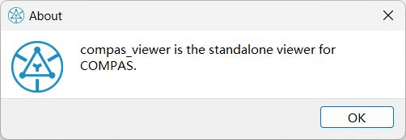
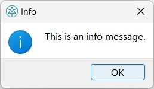
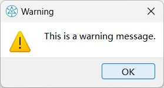
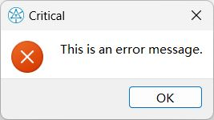
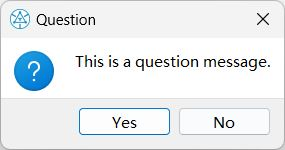
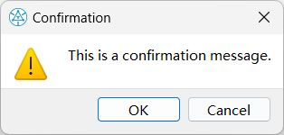

# Windows Messages


You can add window pop-up messages to your viewer using the following methods.


## "About" Message

To display "about" message from the configuration file:

```python
viewer.layout.window.about()

```



## "Info" Message

To display "info" message:

```python
viewer.layout.window.info("This is an info message.")

```


## "Warning" Message

To display "warning" message:

```python
viewer.layout.window.warning("This is a warning message.")

```


## "Critical" Message

To display "critical" message:

```python
viewer.layout.window.critical("This is an error message.")

```


## "Question" Message

To display "question" message:

```python
viewer.layout.window.question("This is a question message.")

```


## "Confirm" Message

To display "confirm" message:

```python
viewer.layout.window.confirm("This is a confirmation message.")

```


