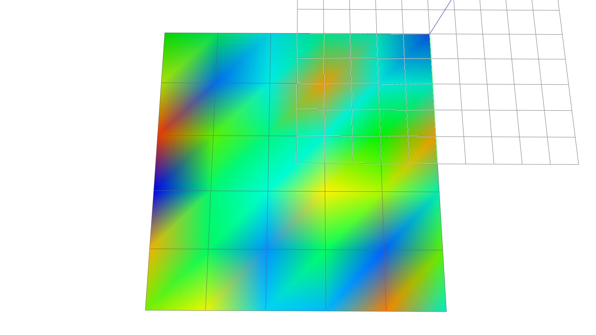

# Vertex Colors

Assign colors by vertex key and enable vertex-color rendering on the mesh scene
object. The seeded color sequence keeps the example output reproducible.



```python
--8<-- "docs/examples/color/vertex_colors.py"
```
