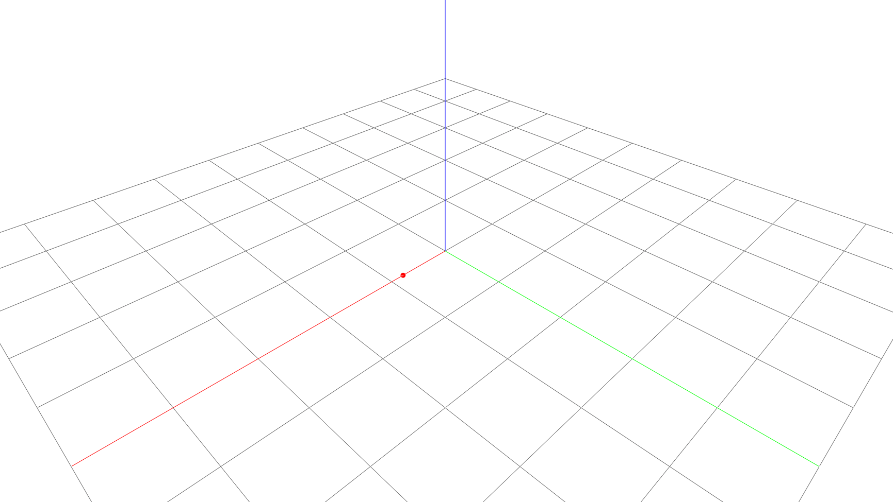

# Dynamic Point

The scene object stores durable display state, while the Viewer render object
owns transient buffers. After changing the represented point, refresh only the
render data derived from it.



```python
--8<-- "docs/examples/dynamic/dynamic.py"
```
