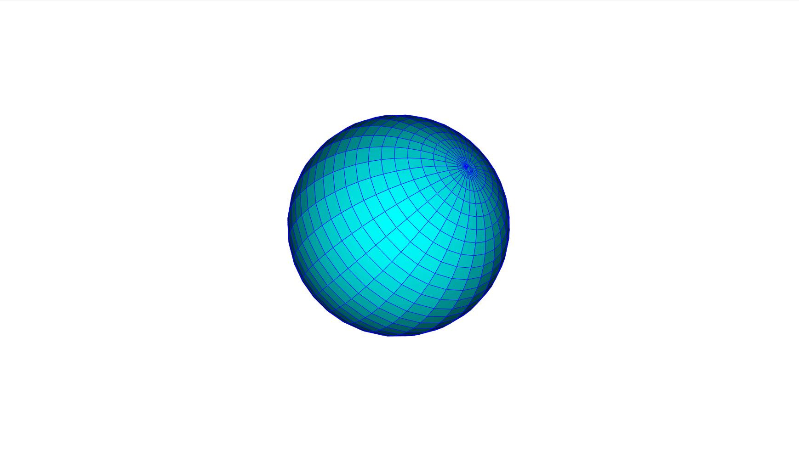

# Orbit Around an Object

Configure persistent renderer settings before constructing the Viewer. Camera
rotation remains runtime state and can be updated by the animation callback.



```python
--8<-- "docs/examples/dynamic/orbiting.py"
```
