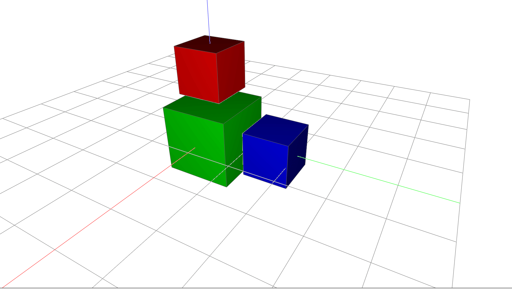

# Transform Scene Objects

Store transformations on stable scene objects, then update the corresponding
transient Viewer render objects.



```python
--8<-- "docs/examples/dynamic/transform.py"
```
