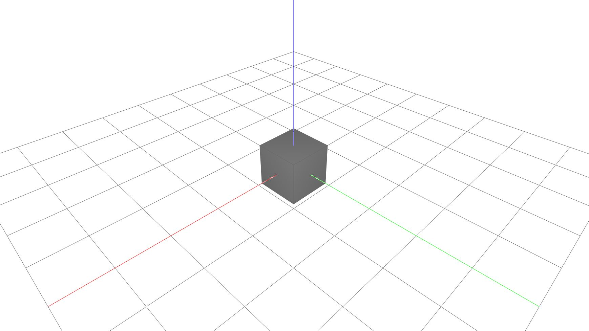

# Brep

This example uses the stable `compas.geometry.Brep` facade. Constructing
the Brep requires an installed COMPAS Brep backend, such as a compatible
`compas_occ` candidate; the viewer itself does not import or own that optional
backend.



```python
--8<-- "docs/examples/object/brep.py"
```
