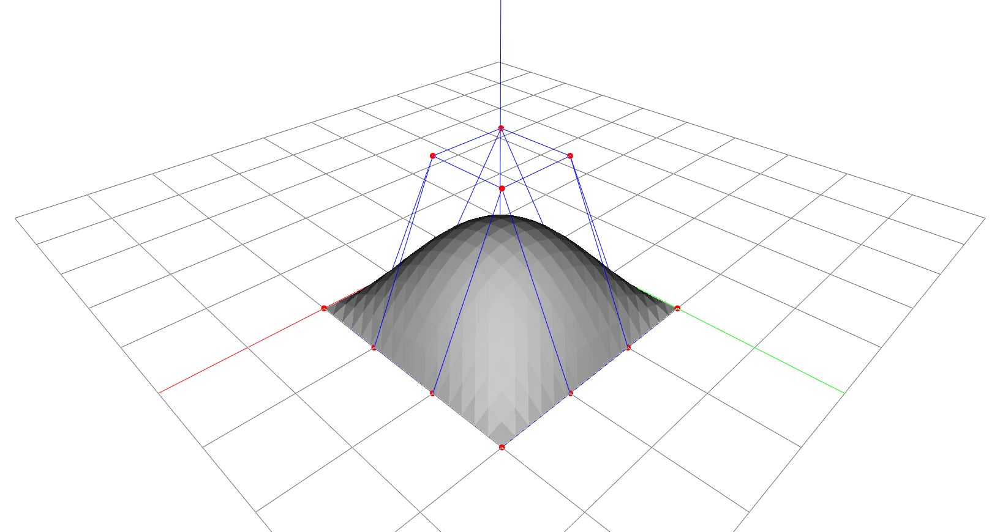

# NURBS Surface

This example requires a NURBS backend plugin. Install a compatible backend,
such as `compas_occ`, before running the script. The NURBS geometry is owned by
COMPAS; the Viewer only displays the surface and its control net.



```python
--8<-- "docs/examples/object/nurbs.py"
```
