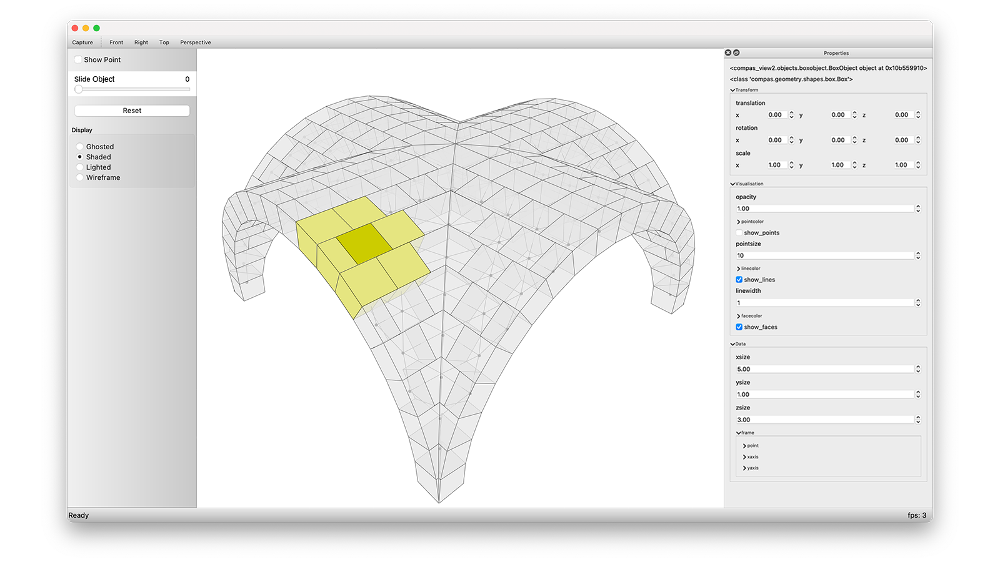

---
hide:
  - navigation
  - toc
---

# COMPAS Viewer

`compas_viewer` is a standalone CAD viewer and data management interface for COMPAS.
It is based on Qt (through PySide6) and OpenGL (through PyOpenGL) and can be installed on Windows, OSX, and Linux to work with COMPAS geometry and data objects without further requirements or additional software.
In addition, `compas_viewer` provides an easy-to-use API to make custom interfaces with specialised controls and widgets.

Start with [Hello World](hello-world.md), continue with the
[user guide](user-guide.md), or explore the [examples](examples.md). Developers
extending the viewer should continue with the [developer guide](developer-guide.md).

The [API reference](api.md) is generated directly from the package's public
Python API and NumPy-style docstrings.
